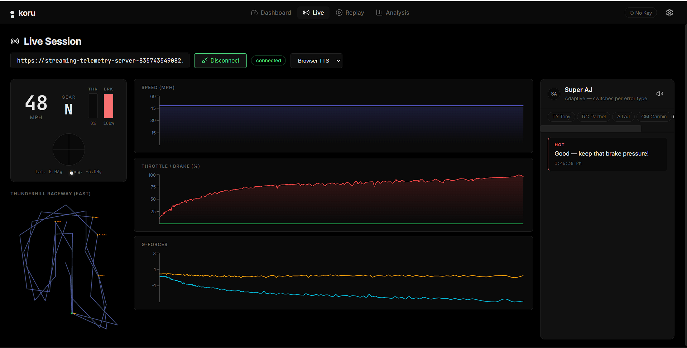

# 🏎️ Building Trustable AI at 100 MPH



## Overview

Official Google Codelab: **[Building Trustable AI at 100 MPH](https://codelabs.developers.google.com/codelabs/trustable-at-100-mph?hl=en)**  
**Updated Official Workshop Repository:** **[https://github.com/seagomezar/trustable-ai-codelab](https://github.com/seagomezar/trustable-ai-codelab)**  
**Co-authored by:** Google Developer Experts (Hemanth HM, Vikram Tiwari, Lynn Langit, **Sebastián Gómez**, Rabimba Karanjai), Googler Ajeet Mirwani, Krupa Galiya, Todd Kerpelman, and Partner Ocupop, Inc.

> **Important Repository & 2026 SDK Notice:**
> - Because the original `ocupop/trustable-ai-codelab` link referenced in Step 5 of the Codelab is no longer available, please clone and use **[`seagomezar/trustable-ai-codelab`](https://github.com/seagomezar/trustable-ai-codelab)** instead.
> - Modernized to **`@google/genai` v3.3+ (`Interactions API`)** with **`gemini-3.8-flash`** (Strategy path), **`gemini-4-argon`** (Lap comparison with automatic Flash fallback), and **`gemini-3.8-flash-lite-tts`** (Expressive voice coaching with automatic Browser Web Speech fallback).
> - Restored clean Codelab baseline for all hands-on experiments (Steps 7, 8, 9, and 10), repaired FastAPI `lifespan` + UTF-8 BOM CSV streaming, added Sonoma Raceway geofences for live `SampleStream2024.csv` feedforward, and included **zero-billing local mode** (`python ingest.py --mock` on `:8000` + built-in `/mock-telemetry.txt`, `/sample-lap-a.csv`, `/sample-lap-b.csv`).

---

## Subdirectories & Boundaries

- **Koru Application**: [./koru-application/README.md](./koru-application/README.md) — React 19 + TypeScript + Vite racing coach simulator implementing the Split-Brain Trustable AI Architecture (`Hot`/`DECISION_MATRIX`, `Cold`/`gemini-3.8-flash`, and `Feedforward` GPS geofences in Live & Replay modes, plus `Predictive` 8-second sample-lap lookahead in Replay mode) with `gemini-4-argon` lap analysis and `gemini-3.8-flash-lite-tts` / Web Speech synthesis.
- **Streaming Telemetry Server**: [./streaming-telemetry-server/README.md](./streaming-telemetry-server/README.md) — Python FastAPI Server-Sent Events (SSE) service emitting 10Hz GPSD `TPV` (or `--binary`) frames from `SampleStream2024.csv` (mock mode) or live USB serial NMEA/binary GPS hardware at `/events` and `/stream`.
- **Codelab Guide (Non-Code Asset)**: [./codelab/index.lab.md](./codelab/index.lab.md) — Step-by-step workshop instructions for the 12-step "Building Trustable AI at 100 MPH" lab.

---

## 📂 Project Structure

1. **`streaming-telemetry-server/`** — FastAPI Server-Sent Events (SSE) service emitting 10Hz GPSD `TPV` frames from `SampleStream2024.csv` (11,539 real VBOX points).
2. **`koru-application/`** — React 19 + TypeScript + Vite racing coach simulator implementing the **Split-Brain Trustable AI Architecture**:
   - **01. Hot / Reflex Path (`<50ms`)**: Deterministic heuristics in `DECISION_MATRIX`.
   - **02. Cold / Strategy Path (`15s` cooldown)**: `gemini-3.8-flash` grounded in `RACING_PHYSICS_KNOWLEDGE` (plus multi-frame `Replay` / `Analysis` breakdowns on demand).
   - **03. Feedforward (`<150m`)**: GPS Haversine geofence corner callouts before turn-in.
   - **04. Predictive (`8s` lookahead in Replay sample mode)**: Previous-lap mistake-zone early warning via `usePredictiveCoaching`.

---

## ⚡ Quick Start (100% Local — No Cloud Billing Needed)

### 0. Clone the Updated Repository
```bash
git clone https://github.com/seagomezar/trustable-ai-codelab.git
cd trustable-ai-codelab
```

### Terminal 1 — Start the 10Hz Telemetry Streaming Server
```bash
cd streaming-telemetry-server
python -m venv .venv

# Activate .venv:
# macOS / Linux:
source .venv/bin/activate
# Windows PowerShell:
.\.venv\Scripts\Activate.ps1

pip install -r requirements.txt
python -m unittest test_nmea_parsing.py
python ingest.py --mock
# -> Streams live SSE at http://localhost:8000/events
```

### Terminal 2 — Start the Koru Racing Car Simulator
```bash
cd koru-application
npm install
npm run dev
# -> Opens at http://localhost:5173
```

1. Open `http://localhost:5173` → **Open Dashboard** → click the **⚙️ Settings** gear (top-right) and paste your Gemini API key from [Google AI Studio](https://aistudio.google.com/app/apikey).
2. Go to **Live** → click **`Local :8000/events`** (or **`Built-in Demo`** if running without Python) to auto-connect immediately (or enter a custom SSE URL and click **Connect**) and watch the gauges, charts, track map, and **5 AI Coach Personas** (`Tony`, `Rachel`, `AJ`, `Garmin`, `Super AJ`) in real time!

---

## ☁️ Google Cloud Run Deployment (Codelab Step 5 & Step 10)

From the `trustable-ai-codelab` root directory:

```bash
gcloud config set project YOUR_PROJECT_ID
gcloud services enable run.googleapis.com cloudbuild.googleapis.com artifactregistry.googleapis.com

gcloud run deploy streaming-telemetry-server \
  --source streaming-telemetry-server \
  --platform managed \
  --region us-central1 \
  --allow-unauthenticated \
  --no-cpu-throttling \
  --max-instances 1 \
  --timeout 3600
```

Connect Koru Live Session to `https://streaming-telemetry-server-<PROJECT_NUMBER>.us-central1.run.app/events`.

**Tear down after the workshop (Step 10):**
```bash
gcloud run services delete streaming-telemetry-server \
  --region us-central1 \
  --platform managed
```

---

## 🏁 Codelab Steps Checklist

- [ ] **Step 1:** Overview — What makes AI trustable at 100 MPH
- [ ] **Step 2:** What You Will Need — GCP / AI Studio key & CLI
- [ ] **Step 3:** Why Trustable AI Matters — Naive vs Trust-Aware AI at Turn 1
- [ ] **Step 4:** High-Velocity AI & Modular Split-Brain Architecture (`Reflex` vs `Strategy`)
- [ ] **Step 5:** Build & Stream the Telemetry Server (`/events` SSE)
- [ ] **Step 6:** Build & Connect the Koru Racing Car Simulator (`localhost:5173`)
- [ ] **Step 7:** Prepare Telemetry for AI Reasoning (`telemetryStreamService.ts`: G-forces & speed threshold)
- [ ] **Step 8:** Add Guardrails & Encoded Human Expertise (`coachingKnowledge.ts`: Friction Circle & Weight Transfer)
- [ ] **Step 9:** Design Coaching Personas & UX (`AJ` polite prompt experiment + Browser/Gemini TTS)
- [ ] **Step 10:** End-to-End Observability (`FRAME`, `Reflex`, `Strategy` DevTools logs) & Cloud Tear-Down
- [ ] **Step 11:** Challenges — Edge AI (Gemini Nano), Rain Traction, Fine-Tuning & Healthcare/Manufacturing/Logistics
- [ ] **Step 12:** Wrap Up & The 5 Pillars of Trustable AI

---

## Interface

- Telemetry SSE Producers (`./streaming-telemetry-server`):
  - `[streaming-telemetry-server/ingest.py:app]`: FastAPI application exposing `GET /` (`[streaming-telemetry-server/ingest.py:root]`), `GET /state` (`[streaming-telemetry-server/ingest.py:get_state]`), `POST /mock` (`[streaming-telemetry-server/ingest.py:update_mock_state]`), and 10Hz SSE endpoints `GET /events` and `GET /stream` (`[streaming-telemetry-server/ingest.py:message_stream]`).
  - CLI flags, env vars, & deployment manifest: `[streaming-telemetry-server/ingest.py:--mock]`, `--serial`, `--binary`, `--port`, `--baud`, `[streaming-telemetry-server/.env.example:HOST]`, `[streaming-telemetry-server/.env.example:PORT]`, and `[streaming-telemetry-server/Procfile:web]`.
- Koru Racing Simulator (`./koru-application`):
  - `[koru-application/package.json:scripts.dev]`, `scripts.build`, `scripts.lint`, `scripts.preview`: Frontend build, lint, preview, and dev entrypoints.
  - `[koru-application/src/App.tsx:App]`, `[koru-application/src/utils/stateMachine.ts:createMachine]` / `useMachine` / `registerKoruMachine` (`window.__KORU_MACHINES__`), `[koru-application/src/services/telemetryStreamService.ts:TelemetryStreamService]`, `[koru-application/src/services/coachingService.ts:CoachingService]`, `[koru-application/src/services/geminiService.ts:GeminiService]`, `[koru-application/src/services/audioService.ts:AudioService]`, `[koru-application/src/hooks/useGeminiCloud.ts:useGeminiCloud]`, `[koru-application/src/hooks/usePredictiveCoaching.ts:usePredictiveCoaching]`, `[koru-application/src/hooks/useTTS.ts:useTTS]`: Client router, typed finite state machines, SSE/mock ingestion consumer, audio engines, and coaching hooks/services.

## Invariants

- Cross-boundary SSE wire contract: `[streaming-telemetry-server/ingest.py:mock_gps_generator]` converts CSV `speed_kmh` to m/s (`/ 3.6`) and `[streaming-telemetry-server/ingest.py:parse_nmea_sentence]` converts NMEA knots to m/s (`* 0.514444`) when emitting GPSD `'TPV'` JSON frames, which `[koru-application/src/services/telemetryStreamService.ts:TelemetryStreamService.processPoint]` multiplies by `3.6` (when `<= 200`, normalizing `TelemetryFrame.speed` in `km/h` across gauges, charts, coaching rules, and prompts) while clamping `gLat`/`gLong` to `[-3, 3]`.
- Split-Brain latency & safety isolation: `[koru-application/src/services/coachingService.ts:CoachingService.runHotPath]` (`1500` ms cooldown on `[koru-application/src/utils/coachingKnowledge.ts:DECISION_MATRIX]`) and `[koru-application/src/services/coachingService.ts:CoachingService.runFeedforward]` (`< 150` m Haversine check against `THUNDERHILL_EAST` + `SONOMA_CORNERS`) execute synchronously without requiring a Gemini API key, while `[koru-application/src/services/coachingService.ts:CoachingService.runColdPath]` enforces a `15000` ms cooldown and fails gracefully on network/key errors.
- Model & TTS fallbacks: `[koru-application/src/hooks/useGeminiCloud.ts:generateFeedback]` and `[koru-application/src/services/geminiService.ts:GeminiService.callApi]` automatically retry `'gemini-4-argon'` failures on `'gemini-3.8-flash'`, and `[koru-application/src/hooks/useTTS.ts:speak]` automatically falls back from `'gemini-3.8-flash-lite-tts'` to browser `window.speechSynthesis`.

## Side Effects

- `[streaming-telemetry-server/ingest.py:lifespan]`, `[streaming-telemetry-server/ingest.py:load_track_data]`, & `[streaming-telemetry-server/ingest.py:serial_reader]`: Loads `.env` (`load_dotenv` in `__main__`), reads `SampleStream2024.csv` in mock mode or opens serial hardware via `serial_asyncio` (calling `sys.exit(1)` on `serial.SerialException`), runs a 10Hz background broadcast task, and serves HTTP/SSE traffic via `uvicorn.run`.
- `[koru-application/src/App.tsx:App]`, `[koru-application/src/services/telemetryStreamService.ts:TelemetryStreamService.connect]`, `[koru-application/src/services/coachingService.ts:CoachingService.runColdPath]`, `[koru-application/src/hooks/useGeminiCloud.ts:generateFeedback]` / `generateAudio`, `[koru-application/src/services/audioService.ts:AudioService]`, and `[koru-application/src/hooks/useTTS.ts:speak]`: Persist `'gemini_api_key'` in browser `localStorage`, open `EventSource` SSE / `fetch` streams, invoke `@google/genai` `client.interactions.create` HTTPS endpoints, and play audio via Web Audio API (`AudioService`), `HTMLAudioElement`, and `window.speechSynthesis` (`useTTS`).

## Verification

- Frontend build & lint: `npm run build` and `npm run lint` (in `workshops/trustable-ai-codelab/koru-application`)
- Telemetry server unit tests: `python -m unittest test_nmea_parsing.py` (in `workshops/trustable-ai-codelab/streaming-telemetry-server`)
- Repository & workshop verification: `npm test` and `node scripts/verify-trustable-ai-workshop.mjs` (from repository root)
