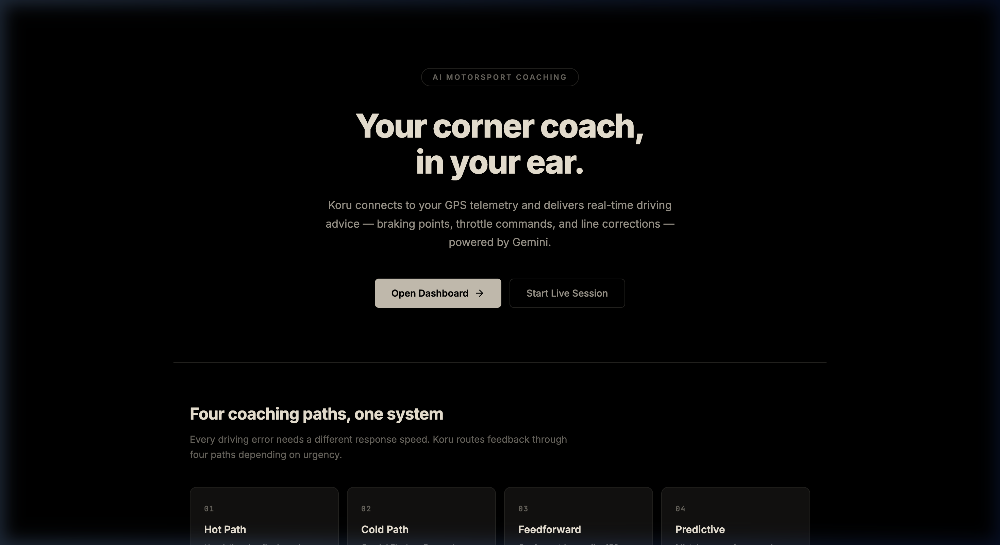

# Koru — Trustable AI Racing Coach

## Overview

Real-time AI driving coach for track days and the **[Building Trustable AI at 100 MPH](https://codelabs.developers.google.com/codelabs/trustable-at-100-mph?hl=en)** Google Codelab. Connect your 10Hz GPS telemetry stream, pick a coach persona, and get braking points, throttle calls, and line corrections spoken into your ear — powered by deterministic guardrails and Google Gemini.



## How the Split-Brain Architecture Works

Koru routes coaching across paths matched to latency budget and urgency:

- **Hot Path (`<50ms`, Live & Replay)** — Deterministic heuristic rules (`DECISION_MATRIX`) fire locally with zero cloud round-trip (`"Trail brake!"`, `"Commit!"`).
- **Cold Path (`15s` live cooldown / on-demand multi-frame)** — `CoachingService.runColdPath` sends single-frame strategy context to `gemini-3.8-flash` (`@google/genai` `Interactions API`) grounded in `RACING_PHYSICS_KNOWLEDGE` on a `15000` ms cooldown, while Replay (`AI Analyze`) and Analysis (`Compare Laps`) analyze multi-frame telemetry windows on demand.
- **Feedforward (`<150m`, Live & Replay)** — GPS Haversine geofences trigger corner briefings 150m before turn-in so you hear advice *before* braking.
- **Predictive (`8s` lookahead, Replay sample mode)** — `usePredictiveCoaching` aligns sample lap telemetry against an ideal reference lap in 5m GPS distance buckets and warns up to 8 seconds before repeating a corner speed loss.

## Coaches

Five AI personas, each with a distinct communication style and voice profile:

| Coach | Style | Example |
|-------|-------|---------|
| **Tony** | Motivational | `"Commit! Trust the grip!"` |
| **Rachel** | Technical | `"Trail off brake before turn-in. Balance the platform."` |
| **AJ** | Direct | `"Brake 5m later."` |
| **Garmin** | Data | `"Entry speed: -8 km/h vs ideal. +0.3s potential."` |
| **Super AJ** | Adaptive | Switches style per error type — safety, technique, or confidence. |

## Quick Start

```bash
git clone https://github.com/seagomezar/trustable-ai-codelab.git
cd trustable-ai-codelab/koru-application
npm install
npm run dev
```

Open `http://localhost:5173` and click **Open Dashboard**.

### Gemini API Key

Click the **⚙️ Settings** gear icon in the navbar and paste your [Gemini API key](https://aistudio.google.com/app/apikey). This enables:

- Cold-path cloud strategy coaching (`gemini-3.8-flash`)
- Post-session AI lap comparison (`gemini-4-argon` with automatic `gemini-3.8-flash` fallback)
- Expressive voice synthesis (`gemini-3.8-flash-lite-tts` with automatic Browser Web Speech API fallback — switch the session header selector from **`Browser TTS`** to **`Gemini TTS`**)

The Hot Path and GPS Geofence Feedforward work even without an API key.

### Modes

- **Live Session** — Click **`Local :8000/events`** (when running `streaming-telemetry-server/ingest.py --mock`) or **`Built-in Demo`** (zero-backend offline demo) to connect immediately, or paste a custom Cloud Run `/events` URL and click **Connect**.
- **Replay** — Upload a telemetry CSV or click **`Load Sample Lap`** to scrub through synchronized speed/throttle/brake/G-force charts (with predictive mistake-zone lookahead on the sample lap) and run **AI Analyze**.
- **Analysis** — Upload two laps or click **`Load Sample Laps A & B`** and run **Compare Laps** for a sector-by-sector Gemini breakdown.

## Tech Stack

- React 19 + TypeScript + Vite
- `@google/genai` (`^3.3.0`, Interactions API) — `gemini-3.8-flash`, `gemini-4-argon`, `gemini-3.8-flash-lite-tts`
- Recharts + SVG 2D track map (`THUNDERHILL_EAST` geometry + Thunderhill East and Sonoma Raceway GPS geofences)
- Server-Sent Events (`EventSource`) for 10Hz GPSD `TPV` telemetry

## Interface

- `[package.json:name]`: Private ES module package `"koru"` (`v1.1.0`, `[package.json:type]` = `"module"`).
- NPM scripts:
  - `[package.json:scripts.dev]`: `"vite"` — launches local Vite development server.
  - `[package.json:scripts.build]`: `"tsc -b && vite build"` — type-checks TypeScript project references and emits production bundle.
  - `[package.json:scripts.lint]`: `"eslint ."` — runs flat ESLint checks across `**/*.{ts,tsx}`.
  - `[package.json:scripts.preview]`: `"vite preview"` — serves the built bundle locally.
- `[vite.config.ts:default]`: Default-exported Vite configuration registering `@vitejs/plugin-react`.
- `[eslint.config.js:default]`: Default-exported flat ESLint configuration combining `@eslint/js`, `typescript-eslint`, `eslint-plugin-react-hooks`, and `eslint-plugin-react-refresh` with browser globals.
- `[tsconfig.json:references]`: Solution TypeScript configuration referencing `./tsconfig.app.json` and `./tsconfig.node.json`.
- `[index.html:#root]` & `[index.html:script]`: Browser HTML shell mounting `<div id="root"></div>` and loading `/src/main.tsx`.
- Static `public/` runtime fixtures: `/mock-telemetry.txt` (JSON-lines built-in demo stream), `/sample-lap-a.csv`, `/sample-lap-b.csv` (VBOX CSV laps playable in Replay, Analysis, and Live `.csv` replay), `/favicon.svg`, and `/icons.svg`.
- Child Subpackage Contract:
  - [Koru Application Source (`src`)](./src/README.md): Application types (`TelemetryFrame`, `GpsSSEPoint`, `Track`, `CoachPersona`, `CoachAction`), router (`App`), stylesheet (`index.css`), and UI/hook/service/utility subpackages.

## Invariants

- `[package.json:private]` & `[package.json:type]`: Package remains private (`true`) and enforces ES module semantics (`"module"`).
- `[package.json:scripts.build]` & `[tsconfig.json:references]`: `vite build` executes only after `tsc -b` succeeds with zero errors across both `./tsconfig.app.json` and `./tsconfig.node.json`.
- `[tsconfig.app.json:compilerOptions]` & `[tsconfig.node.json:compilerOptions]`: Enforce `strict: true`, `noUnusedLocals: true`, `noUnusedParameters: true`, `erasableSyntaxOnly: true`, `verbatimModuleSyntax: true`, `noFallthroughCasesInSwitch: true`, and `noUncheckedSideEffectImports: true`, isolating browser DOM types (`"vite/client"`) in `src` from Node types (`"node"`) in `vite.config.ts`.
- `[eslint.config.js:globalIgnores]`: Ignores `dist/` build artifacts while enforcing React Hooks and Vite React Refresh rules across `**/*.{ts,tsx}`.
- `[index.html:#root]`: Must remain present in `index.html` for `[src/main.tsx:root]` (`document.getElementById('root')!`).

## Side Effects

- `[index.html:script]`, `[index.html:link]`, & `[src/index.css:@import]`: Browser load requests `/favicon.svg`, imports `Inter` and `JetBrains Mono` from `https://fonts.googleapis.com`, and executes `/src/main.tsx` to mount the React application onto `#root`.
- `[package.json:scripts.build]`: Writes incremental TypeScript build info caches under `./node_modules/.tmp/tsconfig.*.tsbuildinfo` (`[tsconfig.app.json:compilerOptions.tsBuildInfoFile]`, `[tsconfig.node.json:compilerOptions.tsBuildInfoFile]`) and outputs bundled static assets to `dist/`.
- `[package.json:scripts.dev]` & `[package.json:scripts.preview]`: Bind local HTTP server sockets via `vite` and `vite preview`.

## Verification

- Run: `npm run build` and `npm run lint` (in `workshops/trustable-ai-codelab/koru-application`)
- Root verification: `npm test` (from repository root)
